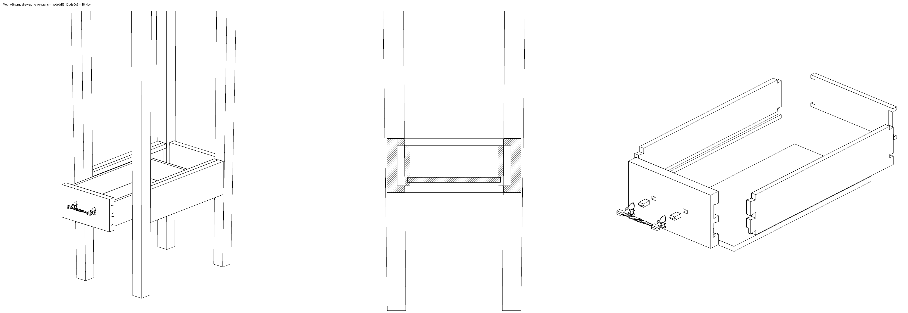

# Check drawings (the line-drawing sheet)

The clearest way to show a joint or a sub-assembly to the maker is one sheet with three line drawings, all from the same model file:

1. **Assembled, 3/4 view, with the moving part pulled out** (a drawer out 4 in, a door open). Shows the part in its housing and what guides it.
2. **Straight-on section through the housing.** A plane cut with hatching on the cut faces, so the clearances, runners, grooves and bottom show at true size.
3. **Exploded view of the part's joinery.** Each part moved out along the axis it assembles on (front forward, sides outward, back rearward, bottom down, hardware forward), so every tail, socket, groove and mortise is visible.



Style: black edge lines only (feature edges over about 30°), no shading, white or paper background, no colour, a one-line title with the model's hash. No dimensions on this sheet; the section is the dimension check.

## How to make it
`scripts/drawings/` renders it from any GLB (metres, Y up) in headless Chromium:
```
cd scripts/drawings && cp /path/to/model.glb model.glb
python3 -m http.server 8911 &
MODEL=model.glb JOBS=jobs_example.json JDIR=out node render_drawings.js
python3 sheet.py out/sheet.png "Drawer check - model <hash>" out/chk_drawer_0.png out/chk_drawer_1.png out/chk_dovetail_0.png
```
A job names the parts by regex (anchored, so write `Stand_Leg_.*`), a label letter and an offset in inches (`off`) for the pulled-out or exploded position, plus a centre and radius (`R`, inches) for the camera. Views: `dir` is the camera direction; an axis-aligned `dir` gives a hatched section through the centre (`cut` moves the plane, in inches). Needs Node and `playwright`; three.js loads from the jsDelivr CDN.

## When to make it
- After every change to a joint, before saying it's done (the second pass in SKILL.md step 7).
- Whenever the maker is about to cut the joint: it is the drawing they work from.
